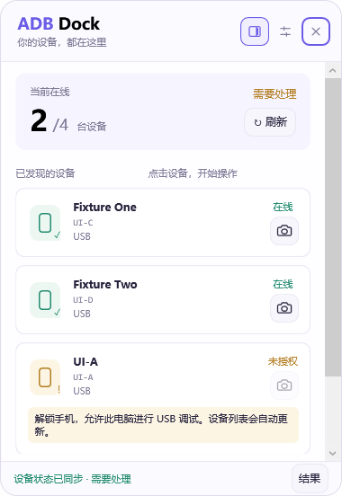
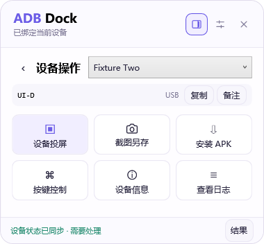
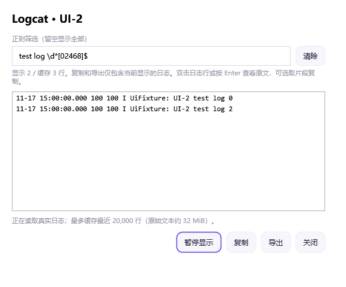
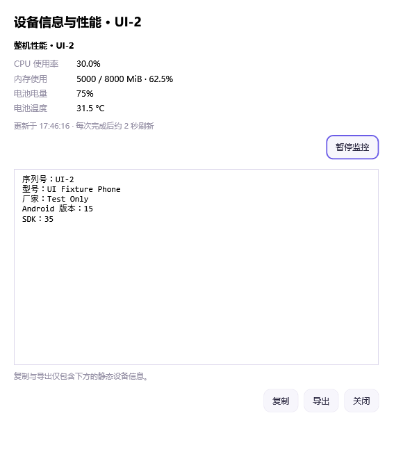
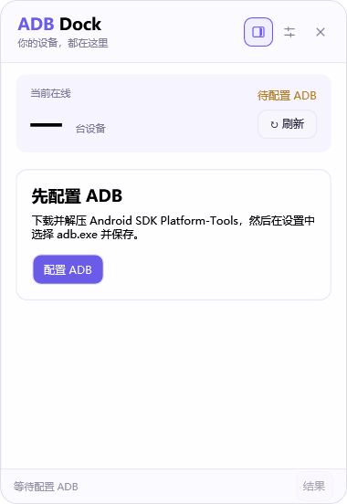
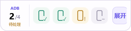

<p align="center">
  
</p>

<h1 align="center">ADB Dock</h1>

<p align="center">Android device status and everyday actions, at the edge of your Windows desktop.</p>

<p align="center"><a href="README.md">简体中文</a> · <strong>English</strong></p>

<p align="center"><a href="https://github.com/rusion2/adb-dock/releases/download/v0.1.3-beta.4/AdbDock-0.1.3-beta.4-win-x64-Setup.exe"><strong>Download the v0.1.3-beta.4 pre-release installer (Windows x64)</strong></a></p>

<p align="center">Device connections require ADB. scrcpy is optional for mirroring. Download each tool separately.<br><a href="https://developer.android.com/tools/releases/platform-tools">Official Android SDK Platform-Tools (includes ADB)</a> · <a href="https://github.com/Genymobile/scrcpy">Official scrcpy</a></p>

<p align="center"><code>Windows x64</code> · <code>.NET 10</code> · <code>WPF</code></p>

<p align="center">
  <a href="#quick-start">Get started</a> · <a href="#upgrade">Upgrade</a> · <a href="#preview">Screenshots</a> · <a href="#usage">Usage</a> · <a href="#development">Build from source</a> · <a href="#packaging">Packaging</a>
</p>

ADB Dock is a local Windows companion for Android devices. Check connection status, choose a device, then mirror its screen, save a screenshot, install an APK, send a basic key event, or inspect logs. It switches between a device panel and a compact edge tab, with no account or backend service required.

In **`v0.1.3-beta.4`**, the floating tab remembers where it was docked. On first collapse, it sits one-third of the way down the right edge of the work area. Active operations survive temporary ADB listener or device-list failures. Operations on the old connection end if the same serial reconnects with a new transport ID. [Upgrade instructions](#upgrade)

Earlier `0.1.x` packages are test builds, including those without a beta suffix. Each future stable release will have its own `release/vX.Y.Z` branch and matching `vX.Y.Z` tag. [Versioning policy](docs/versioning.md)

## Features

- **Clear device status**: distinguish online, unauthorized, offline, no devices, and ADB failures, with separate online and discovered counts.
- **Four-edge docking and a system tray**: the floating tab is enabled by default. Closing the panel returns to the edge tab when enabled, or hides it to the tray when disabled. Automatic collapse has its own switch and adjustable delay.
- **Six everyday tools**: scrcpy mirroring, PNG screenshots, APK installation, Home / Back / Recent / Wake keys, device information, and Logcat. Every device action targets the selected serial number.
- **Regex log filtering**: retain up to 20,000 recent lines, filter or clear the view, pause display, copy, and export.
- **Whole-device monitoring**: manually start or pause CPU, memory, battery level, and battery-temperature sampling from device information.
- **Per-user installation**: the installer includes the .NET runtime and supports sign-in startup and uninstallation, without administrator privileges.

<a id="preview"></a>
## Screenshots

These are native WPF windows with fixture devices, logs, and metrics. The application UI is currently in Chinese; this repository provides documentation in Chinese and English.

<p align="center">
  
  
</p>

<p align="center">
  
  
</p>

<p align="center">
  
  
</p>

<a id="quick-start"></a>
## Get started

Check GitHub Releases for published packages. You can also run the app from source or build an installer or portable ZIP locally. [GitHub Releases](https://github.com/rusion2/adb-dock/releases) · [Build from source](#development) · [Build packages locally](#packaging)

- **Installer**: run the generated `*win-x64-Setup*.exe`. It installs to `%LOCALAPPDATA%\Programs\AdbDock` by default, includes the .NET 10 runtime, and adds Start menu and uninstall entries. A desktop shortcut is optional.
- **Portable**: extract the entire ZIP, then run `AdbDock.exe`. The default portable package requires the **Windows x64 .NET 10 Desktop Runtime**; a `self-contained` package includes its runtime.

On a first installation, “Start ADB Dock when I sign in to Windows” is selected by default. You can turn it off in the wizard or later in Settings.

<a id="upgrade"></a>
### Upgrade an existing installation

1. Run the new Windows x64 installer. Your current session stays open while you choose the installation options.
2. Click **Install**. Setup asks the installed copy to quit, including when its panel is hidden in the tray. It waits for the process to exit before replacing files. If setup reports that ADB Dock is still running, finish any open operation, choose **退出 ADB Dock** (Exit ADB Dock) from its tray menu, then click **Retry**.
3. Launch ADB Dock and check the version at the bottom of Settings. The upgrade preserves your settings, screenshots, and previous sign-in startup choice.

### Configure ADB and scrcpy

1. Extract the full Windows Android SDK Platform-Tools archive. For mirroring, also extract the full Windows scrcpy archive.
2. Open **Settings** in the upper-right corner and select `adb.exe` from the extracted folder. Select `scrcpy.exe` if you want mirroring. You can also add the tool folders to `PATH` and leave the corresponding fields blank.
3. Click **检测工具** (Detect tools) to see separate results for ADB and scrcpy. A working ADB is enough to connect devices, and you can leave the scrcpy path blank. Click **保存** (Save) to apply the paths and refresh the device list.

ADB Dock checks the configured path first, then the system `PATH`, and finally the `tools/` directory beside the application. If a configured path is invalid, correct or clear it in Settings.

<details>
<summary>Place tools beside the application</summary>

```text
AdbDock.exe
AdbDock.dll
...other published files
tools/
  platform-tools/
    adb.exe
    ...DLLs, dependencies, and license files from the official distribution
  scrcpy/
    scrcpy.exe
    ...server, DLLs, dependencies, and license files
```

Keep each distribution complete rather than copying only its executable.

</details>

### Connect a device

1. Unlock your Android device and enable **USB debugging** in **Developer options**.
2. Connect it to your PC with a USB data cable. When the phone asks **Allow USB debugging?**, confirm that it is your computer and tap **Allow**.
3. The device list refreshes automatically. Once your device shows **在线** (Online), click it to open its actions. If it shows **未授权** (Unauthorized), check the phone for the prompt. If it shows **离线** (Offline), click it for connection guidance.

Devices already connected over the network through ADB also appear in the list. APK installation and key events act on the selected device. Check its serial number before proceeding.

<a id="usage"></a>
## Usage

### Desktop controls

- Click **展开** (Expand) at the end of the edge tab to open the full device list.
- Click a device icon on the tab, or swipe left from the icon, to open its action panel. Offline or unauthorized devices open connection guidance.
- **Switch devices** with the selector beside the **设备操作** (Device actions) heading. The closed selector shows the current device name. Hover to see its full name, serial number, and status. The list shows all three for each online device and supports keyboard selection. Operations already in progress keep their original target.
- Click **备注** (Alias) on the action panel or use the device list context menu to save a local device alias. Its first character appears on the edge tab.
- Click the camera in the device list to save a PNG directly to the configured folder. **打开图片** (Open image) opens the latest one. **截图另存** (Save screenshot as) on the action panel lets you pick a path and filename.
- Use the title-bar **显示浮窗** (Show floating tab) switch to choose where the close button sends the panel. With the switch on, closing the panel returns it to the edge tab. With the switch off, closing hides it in the tray. Double-click the tray icon to reopen the panel.
- **Automatic collapse** starts after ADB Dock first sees an online device. The app remembers this across restarts and continues to use your settings after devices disconnect. When both the floating tab and automatic collapse are enabled, the countdown begins when the pointer leaves the panel and the tab’s original location. The default is **2 seconds**. In Settings you can turn it off or choose **1–300 seconds**, then click **保存** (Save). Returning to the panel or tab position cancels the countdown. Dragging and interacting with a menu, dialog, or file picker pause it.
- **Move the edge tab** by dragging the ADB/device-count area. Movement begins as soon as the pointer crosses the Windows drag threshold. Releasing in place keeps the tab compact. With keyboard focus on that area, use the arrow keys to choose a screen edge. To dock the full panel manually, enable the floating tab, drag the title bar toward any screen edge, and release.
- **结果** (Results) holds the latest 20 operation results for this session. Use it to copy or export results, or open the most recent screenshot. To quit the application, choose **退出 ADB Dock** from the tray or context menu. The Settings footer shows the running version.

The native app saves preferences locally. The prototype stores device aliases in the current browser.

### Log filtering

Enter a regular expression in Logcat, for example:

```regex
error|fatal
```

Matching is case-sensitive by default. Use `(?i)error|fatal` to ignore case. Clearing the expression restores all currently retained lines. Invalid expressions keep the last valid filter; expensive expressions suspend filtering and display a message asking you to change the pattern.

The cache retains up to **20,000 lines**, bounded by approximately **32 MiB of raw text**, with at most 8,000 characters per line. Copy and export use the currently displayed text. **Pause display** holds your reading position while incoming lines continue to enter the cache. **Jump to latest** shows the matching lines still retained.

### Performance monitoring

Open device information and click “开始监控” to sample whole-device CPU usage, used/total memory, battery level, and **battery temperature**. CPU usage requires two valid samples. Each completed sample is followed by a wait of about two seconds. Unavailable metrics display a reason while other metrics continue updating.

Pausing, closing the window, or disconnecting the device stops sampling. Reconnection requires an explicit restart. Copy and export in this window include static device information only.

### Settings and uninstallation

Settings and local error logs are stored in `%LOCALAPPDATA%\AdbDock` by default. Portable and source builds do not register sign-in startup automatically; installed builds follow the wizard and Settings selection. Sign-in startup does not restart the application after a crash.

Exit ADB Dock from its tray menu before uninstalling through Windows Installed apps or the Start menu. Removal deletes bundled application files, shortcuts, and the matching startup entry, while retaining user settings, logs, screenshots, and unrelated files added to the installation directory. Quitting stops only this application's client sessions, leaving the shared ADB server running.

<a id="development"></a>
## Build from source

Requires **Windows x64, Git, and the .NET 10 SDK**. Run in PowerShell:

```powershell
git clone https://github.com/rusion2/adb-dock.git
cd adb-dock
dotnet build .\AdbDock.sln -c Release --disable-build-servers -m:1 -nr:false
.\src\AdbDock.App\bin\Release\net10.0-windows\AdbDock.exe
```

### Automated checks

After building, run the core checks without a third-party test framework:

```powershell
.\tests\AdbDock.Checks\bin\Release\net10.0\AdbDock.Checks.exe
```

<details>
<summary>Native UI, startup registration, and installer checks</summary>

UI checks require an interactive Windows desktop. They use a separate instance identity, fixture devices, and isolated settings, so they can run alongside the installed client without installing applications or sending keys to real phones. Published startup and single-instance smoke checks still use the production entry point; exit the existing client from the tray before running those checks.

```powershell
$fixture = (Resolve-Path '.\tests\AdbDock.Checks\bin\Release\net10.0\AdbDock.Checks.exe').Path
$uiChecks = (Resolve-Path '.\tests\AdbDock.UiChecks\bin\Release\net10.0-windows\AdbDock.UiChecks.exe').Path
& $uiChecks $fixture (Join-Path $PWD 'artifacts\ui-checks')
& $uiChecks --startup-checks (Join-Path $PWD 'artifacts\startup-checks')
```

Startup checks use temporary registry keys and do not change the real startup entry. Installer checks use separate installation directories, shortcuts, and test registry keys:

```powershell
.\scripts\TestInstaller.ps1 `
  -PayloadDirectory 'C:\path\to\self-contained-output' `
  -NsisCompilerPath 'C:\path\to\makensis.exe'
```

</details>

Core and native UI checks cover first-time connection, ADB discovery recovery, same-serial reconnection, screenshot validation, pausing Logcat, and docking the floating tab. See the development record for installation, physical device, and multi-monitor DPI verification. [Development record](docs/development.md)

<a id="packaging"></a>
## Packaging

```powershell
# Self-contained Windows x64 installer: build, core checks, publish, and NSIS
.\scripts\BuildInstaller.ps1

# Portable ZIP requiring the Desktop Runtime
.\scripts\Publish.ps1

# Portable ZIP with its runtime included
.\scripts\Publish.ps1 -SelfContained
```

Outputs go to `artifacts\`, including the installer or ZIP, a SHA256 checksum, and validation metadata in JSON. Each run uses a new output directory and preserves previous artifacts. The installer supports per-user sign-in startup by default; ADB and scrcpy still need separate configuration.

The first build needs network access to restore runtime packages. The installer script downloads and verifies a pinned NSIS 3.13 portable compiler without installing NSIS system-wide. For installer builds, runtime packages are cached in `.build\nuget-packages`.

<details>
<summary>Advanced packaging options</summary>

- Both scripts support `-IncludeUiChecks` for native-window and published-app startup checks; use an interactive desktop and exit other clients first.
- `-SkipChecks` skips core checks; use it only after separate verification. The skip is recorded in JSON. It cannot be combined with `-IncludeUiChecks`.
- The installer script accepts `-NsisCompilerPath` for an existing NSIS 3.13 compiler and `-PayloadDirectory` for a complete self-contained output folder.
- Keep the full runtime payload. The script adds project documentation, .NET licensing and third-party notices, and an exact uninstall manifest.

</details>

## Troubleshooting

- **ADB unavailable**: verify the configured path, run tool detection, and check that companion DLLs are present.
- **Unauthorized or offline device**: unlock the phone, confirm USB debugging authorization, and check that your USB cable supports data transfer. The device status refreshes automatically.
- **Mirroring fails**: check the complete scrcpy distribution and its path. A mirroring failure does not change the ADB online count.
- **Portable app will not start**: install the .NET 10 **Desktop Runtime**, or use a self-contained package.
- **Build fails in a restricted environment**: set `$env:MSBuildEnableWorkloadResolver = 'false'` in the current PowerShell session. To isolate CLI settings, also set `$env:DOTNET_CLI_HOME = Join-Path $PWD '.build\dotnet-home'`.

## Project layout and further reading

```text
src/AdbDock.App/        WPF windows, tray, settings, logs, and monitoring UI
src/AdbDock.Core/       ADB communication, cancellation, processes, and mirroring
tests/                 Core and native-window checks
installer/             NSIS installation and uninstallation
scripts/               Packaging, installer validation, and icon generation
docs/                  Requirements, verification, versioning, and screenshots
index.html             Browser interaction prototype; simulated devices/actions only
```

[Requirements and acceptance criteria (Chinese)](docs/requirements.md) · [Development record (Chinese)](docs/development.md) · [Versioning policy](docs/versioning.md) · [Report an issue](https://github.com/rusion2/adb-dock/issues)
