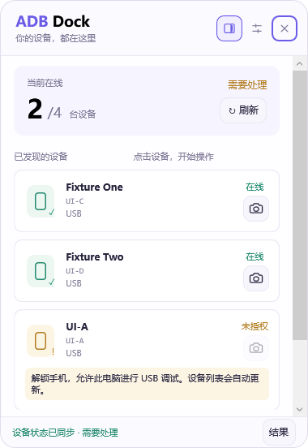
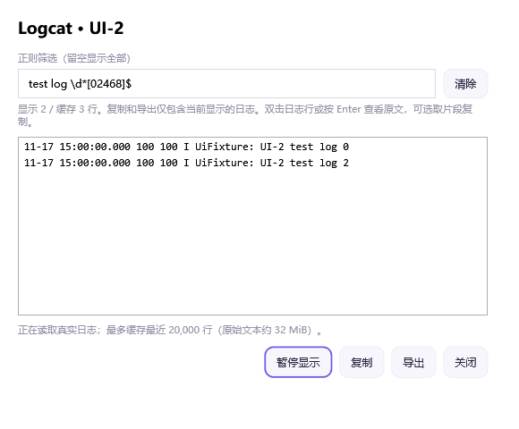
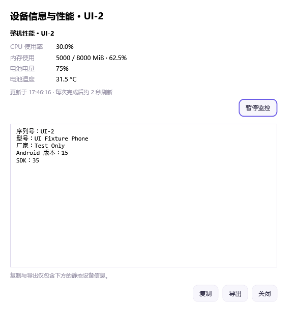
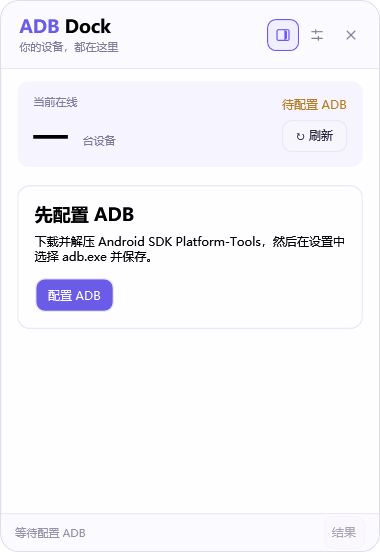

<p align="center">
  
</p>

<h1 align="center">ADB Dock</h1>

<p align="center">把 Android 设备状态和常用操作，放到 Windows 桌面边缘。</p>

<p align="center"><strong>简体中文</strong> · <a href="README.en.md">English</a></p>

<p align="center"><a href="https://github.com/rusion2/adb-dock/releases/download/v0.1.3-beta.4/AdbDock-0.1.3-beta.4-win-x64-Setup.exe"><strong>下载 v0.1.3-beta.4 测试版安装包（Windows x64）</strong></a></p>

<p align="center">连接设备需要 ADB，投屏才需要 scrcpy。两项工具均需单独获取。<br><a href="https://developer.android.com/tools/releases/platform-tools">官方 Android SDK Platform-Tools（含 ADB）</a> · <a href="https://github.com/Genymobile/scrcpy">官方 scrcpy</a></p>

<p align="center"><code>Windows x64</code> · <code>.NET 10</code> · <code>WPF</code></p>

<p align="center">
  <a href="#quick-start">快速开始</a> · <a href="#upgrade">升级旧版</a> · <a href="#preview">界面预览</a> · <a href="#usage">功能用法</a> · <a href="#development">源码构建</a> · <a href="#packaging">打包发布</a>
</p>

ADB Dock 是一个本地运行的 Windows Android 设备助手：查看设备是否在线，选择目标设备，再进行投屏、截图、安装 APK、按键控制或日志排查。展开时是设备面板，收起时是贴边状态条，无需账号或后端服务。

**`v0.1.3-beta.4` 测试版**会记住浮窗的停靠位置，首次收起时默认停在工作区右侧三分之一高度处。ADB 监听或设备列表查询短暂出错时，正在进行的操作会继续。同一序列号的设备重连并获得新传输 ID 后，旧连接上的操作会结束。详见[升级步骤](#upgrade)与[版本及正式发布分支约定](docs/versioning.md)。

## 主要功能

- **设备状态一眼可见**：区分在线、未授权、离线、无设备和 ADB 异常，统计在线数与发现总数。
- **四边停靠与托盘常驻**：“显示浮窗”默认开启；关闭面板时收为贴边条，关闭显示浮窗后则仅在主动关闭时隐藏到托盘。自动收起可单独开关并调整延时。
- **六项常用操作**：scrcpy 投屏、PNG 截图、APK 安装、Home / 返回 / 最近任务 / 亮屏、设备信息和 Logcat。操作始终绑定所选序列号。
- **正则日志筛选**：缓存最近最多 20,000 行，支持筛选、清除、暂停显示、复制和导出。
- **整机性能监控**：在设备信息中查看 CPU、内存、电量和电池温度，支持手动开始、暂停与断连停止。
- **当前用户安装**：安装版自带 .NET 运行时，支持登录启动与卸载；不需要管理员权限。

<a id="preview"></a>
## 界面预览

以下为原生 WPF 界面，设备、日志和指标均来自测试数据。应用界面目前为中文；本仓库提供中英文文档。

<p align="center">
  
  
</p>

<p align="center">
  
  
</p>

<p align="center">
  
  
</p>

<a id="quick-start"></a>
## 快速开始

可在 [GitHub Releases](https://github.com/rusion2/adb-dock/releases) 查看是否有适用的安装包。也可以直接[从源码运行](#development)，或用[打包脚本](#packaging)在本地生成安装包或便携包。

- **安装版**：运行生成的 `*win-x64-Setup*.exe`。默认安装到 `%LOCALAPPDATA%\Programs\AdbDock`，自带 .NET 10 运行时，提供开始菜单和卸载入口，桌面快捷方式可选。
- **便携版**：完整解压 ZIP 后运行 `AdbDock.exe`。默认便携版需要 **Windows x64 .NET 10 Desktop Runtime**；`self-contained` 版本已包含运行时。

首次安装时默认勾选“登录 Windows 后自动启动”，可在安装向导或应用设置中关闭。

<a id="upgrade"></a>
### 升级已安装的版本

1. 旧版可以继续运行，或留在系统托盘。打开新版 `*win-x64-Setup*.exe`，在向导中点击 **安装**。
2. 安装器会请求旧版正常退出，等它保存设置并关闭后再替换文件。如果旧版没有响应，安装器会在覆盖文件前停下。此时请完成当前操作，在托盘菜单选择 **退出 ADB Dock**，然后回到向导点击 **重试**。
3. 安装完成后启动 ADB Dock，在**设置**底部确认版本号。已有配置和截图会保留，此前关闭的登录自启动也会保持关闭。

### 配置 ADB 与 scrcpy

1. 完整解压 Windows 版 Android SDK Platform-Tools。如需投屏，再完整解压 Windows 版 scrcpy。
2. 打开右上角的 **设置**，在 **ADB 路径**中选择解压目录里的 `adb.exe`。如需投屏，在 **scrcpy 路径**中选择 `scrcpy.exe`。也可将工具目录加入 `PATH`，并将对应设置留空。
3. 点击 **检测工具**，分别查看 ADB 和 scrcpy 的检测结果。ADB 可用时即可连接设备，scrcpy 可以留空。点击 **保存** 应用路径并刷新设备列表。

工具依次从 **设置中的指定路径 → 系统 PATH → 程序目录 `tools/`** 查找。指定路径无效时，请在设置中更正或清空。

<details>
<summary>将工具放在程序目录中</summary>

```text
AdbDock.exe
AdbDock.dll
...其他发布文件
tools/
  platform-tools/
    adb.exe
    ...官方发行目录中的 DLL、依赖与许可文件
  scrcpy/
    scrcpy.exe
    ...服务端、DLL、依赖与许可文件
```

保留工具的完整发行文件，不要只复制可执行文件。

</details>

### 连接设备

1. 解锁 Android 设备，在 **开发者选项**中开启 **USB 调试**。
2. 用支持数据传输的 USB 线连接电脑。手机弹出 **允许 USB 调试吗？** 时，确认是当前电脑后点击 **允许**。
3. 设备列表会自动刷新。设备显示 **在线** 后，点击该设备进入操作页。若显示 **未授权**，请在手机上确认授权；若显示 **离线**，可点击设备查看连接指引。

通过 ADB 建立的网络连接也会显示在设备列表中。安装 APK 和发送按键会作用于所选设备，执行前请确认页面中的序列号。

<a id="usage"></a>
## 功能用法

### 桌面交互

| 想做什么 | 操作 |
| --- | --- |
| 查看全部设备 | 点击浮窗末端的 **展开**，再点击一台在线设备进入操作面板。 |
| 直接操作一台设备 | 点击浮窗上的设备图标，或从图标向左滑动，直接打开所选设备的操作面板。点击离线或未授权设备会显示连接指引。 |
| 切换操作目标 | **设备操作** 标题旁的选择器收起时只显示当前设备名称，悬停可查看完整名称、序列号和状态。展开后列出在线设备的名称、序列号和状态，支持键盘选择。已开始的操作仍绑定原设备。 |
| 区分同名设备 | 在操作面板点击 **备注**，也可在设备列表右键编辑。备注保存在本机，浮窗显示备注的首个字符。 |
| 快捷截图 | 点击设备列表中的相机按钮，直接将 PNG 保存到设置中的截图目录。底栏的 **打开图片** 会打开最近一张。操作面板的 **截图另存** 可以指定位置和文件名。 |
| 移动浮窗 | 按住 **ADB／数量** 区域直接拖动，达到 Windows 的拖动阈值后浮窗就会移动。原地松手保持收起，使用键盘时可聚焦该区域，用方向键切换停靠边。 |
| 关闭面板或退出 | 标题栏的 **显示浮窗** 默认开启。点击 **×** 后回到贴边浮窗；若已关闭此开关，面板会隐藏到托盘。托盘菜单中的 **显示设备面板** 可重新打开，**退出 ADB Dock** 可结束程序。 |

**完整面板的自动收起**从首次发现在线设备后才开始生效。应用会记住已完成首次连接，断开设备或重启应用后仍按设置收起。**显示浮窗**和自动收起均开启时，鼠标连续离开面板和原浮窗位置，默认 **2 秒**后收起。可在设置中关闭自动收起，或将等待时间改为 **1–300 秒**，点击 **保存** 生效。鼠标移回会取消倒计时，拖动、使用菜单或对话框时会暂停计时。开启 **显示浮窗**时，可把面板标题栏拖到屏幕边缘，松手即可手动收起。

底部的 **结果** 保留本次运行最近 20 条操作反馈，可复制、导出或打开最近截图。浏览器原型使用模拟任务栏图标重新打开面板，设备备注保存在当前浏览器。

### 日志筛选

在“查看日志”的正则输入框中填写表达式，例如：

```regex
error|fatal
```

默认区分大小写。使用 `(?i)error|fatal` 可忽略大小写；清除表达式可恢复当前缓存中的全部日志。无效表达式保留上一次有效筛选，耗时过长的表达式会暂停筛选并提示修改。

缓存最多保留 **20,000 行**，同时限制为约 **32 MiB 原始文本**，单行最多 8,000 字符。复制和导出以当前显示内容为准。**暂停显示**会保留阅读位置，后台继续缓存新日志并统计新增行数。点击 **回到最新** 可查看缓存中保留的匹配内容。

### 性能监控

进入“设备信息”，点击“开始监控”读取整机 CPU 占用、已用 / 总内存、电量和**电池温度**。CPU 需要两个有效样本；每次采样完成后等待约 2 秒再刷新。部分指标无法读取时会显示原因，其他指标继续更新。

暂停、关闭窗口或设备断开会停止采样，重连后需手动开始。该窗口的复制与导出仅包含静态设备信息。

### 配置与卸载

配置和本地错误日志默认位于 `%LOCALAPPDATA%\AdbDock`。便携版与源码运行不会自行注册登录启动；安装版以安装向导和设置中的选择为准。登录启动不包含崩溃后自动拉起。

卸载前，在托盘菜单选择 **退出 ADB Dock**，再从 Windows“已安装的应用”或开始菜单卸载。卸载移除本程序随附的文件、快捷方式和对应启动项，保留用户配置、日志、截图及安装目录中后来加入的无关文件。退出只结束本程序的客户端会话，不停止共享 ADB server。

<a id="development"></a>
## 从源码构建

需要 **Windows x64、Git 和 .NET 10 SDK**。在 PowerShell 中执行：

```powershell
git clone https://github.com/rusion2/adb-dock.git
cd adb-dock
dotnet build .\AdbDock.sln -c Release --disable-build-servers -m:1 -nr:false
.\src\AdbDock.App\bin\Release\net10.0-windows\AdbDock.exe
```

### 自动检查

完成构建后，运行无需第三方测试框架的核心检查：

```powershell
.\tests\AdbDock.Checks\bin\Release\net10.0\AdbDock.Checks.exe
```

<details>
<summary>原生界面、自启动与安装流程检查</summary>

UI 检查需要可交互的 Windows 桌面，使用独立实例标识、假设备和独立配置，可与已安装客户端并行运行，不向真实手机安装应用或发送按键。发布程序启动与单实例检查仍使用正式入口，运行该项前需从托盘退出已有客户端。

```powershell
$fixture = (Resolve-Path '.\tests\AdbDock.Checks\bin\Release\net10.0\AdbDock.Checks.exe').Path
$uiChecks = (Resolve-Path '.\tests\AdbDock.UiChecks\bin\Release\net10.0-windows\AdbDock.UiChecks.exe').Path
& $uiChecks $fixture (Join-Path $PWD 'artifacts\ui-checks')
& $uiChecks --startup-checks (Join-Path $PWD 'artifacts\startup-checks')
```

自启动专项使用临时注册表测试键，不修改实际启动项。安装、升级和卸载检查使用独立安装目录、快捷方式和测试注册表：

```powershell
.\scripts\TestInstaller.ps1 `
  -PayloadDirectory 'C:\path\to\self-contained-output' `
  -NsisCompilerPath 'C:\path\to\makensis.exe'
```

</details>

核心和原生界面检查覆盖首次连接、ADB 发现异常恢复、同一序列号重连、截图校验、日志暂停和浮窗停靠。安装流程、真机和多屏 DPI 的验收范围见[开发进度](docs/development.md)。

<a id="packaging"></a>
## 打包发布

```powershell
# 自包含 Windows x64 安装程序：构建、核心检查、发布、NSIS 打包
.\scripts\BuildInstaller.ps1

# 需要 Desktop Runtime 的便携 ZIP
.\scripts\Publish.ps1

# 自带运行时的便携 ZIP
.\scripts\Publish.ps1 -SelfContained
```

输出写入 `artifacts\`，包含安装程序或 ZIP、SHA256 校验文件及验证信息 JSON。每次使用新目录，保留已有产物。安装包默认支持当前用户登录启动，仍需单独配置 ADB / scrcpy。

首次打包需要联网还原运行时包；安装器脚本会下载并校验固定版本的 NSIS 3.13 便携编译器，不向系统安装 NSIS。安装器构建的运行时包缓存位于 `.build\nuget-packages`。

<details>
<summary>高级打包选项</summary>

- 两个脚本均支持 `-IncludeUiChecks`，额外执行原生窗口和发布启动检查；需要可交互桌面并退出其他客户端。
- `-SkipChecks` 跳过核心检查，仅在已单独完成验证后使用；跳过状态会写入 JSON，不能与 `-IncludeUiChecks` 同用。
- 安装器支持 `-NsisCompilerPath` 指定已有 NSIS 3.13 编译器，以及 `-PayloadDirectory` 复用完整自包含发布目录。
- 自包含目录必须保留全部运行时文件；脚本会补入项目说明、.NET 许可和第三方声明，并生成精确卸载清单。

</details>

## 常见问题

- **ADB 不可用**：确认已完整解压 Windows 版 Platform-Tools，再在设置中检测并保存路径。
- **设备未授权或离线**：解锁手机确认 USB 调试授权，并检查 USB 线是否支持数据传输。应用会自动刷新状态。
- **投屏无法启动**：检查 scrcpy 完整发行目录及路径；投屏失败不会改变 ADB 在线数量。
- **便携程序不能启动**：确认安装的是 .NET 10 **Desktop Runtime**，或使用自包含版本。
- **受限环境构建失败**：可在当前 PowerShell 会话设置 `$env:MSBuildEnableWorkloadResolver = 'false'`；需要隔离 CLI 配置时，再设置 `$env:DOTNET_CLI_HOME = Join-Path $PWD '.build\dotnet-home'`。

## 项目结构与更多说明

```text
src/AdbDock.App/        WPF 窗口、托盘、设置、日志与性能界面
src/AdbDock.Core/       ADB 通信、任务取消、进程与投屏会话
tests/                 核心检查与原生窗口检查
installer/             NSIS 安装与卸载脚本
scripts/               打包、安装验证与图标生成
docs/                  需求、验收、版本约定与原生界面截图
index.html             浏览器交互原型，仅使用模拟设备与命令
```

[需求与验收基线](docs/requirements.md) · [开发进度与待验收项目](docs/development.md) · [版本约定](docs/versioning.md) · [反馈问题](https://github.com/rusion2/adb-dock/issues)
