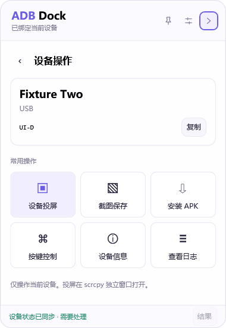

<p align="center">
  
</p>

<h1 align="center">ADB Dock</h1>

<p align="center">把 Android 设备状态和常用操作，放到 Windows 桌面边缘。</p>

<p align="center"><strong>简体中文</strong> · <a href="README.en.md">English</a></p>

<p align="center"><code>Windows x64</code> · <code>.NET 10</code> · <code>WPF</code> · <code>v0.1.2</code></p>

<p align="center">
  <a href="#quick-start">快速开始</a> · <a href="#preview">界面预览</a> · <a href="#usage">功能用法</a> · <a href="#development">源码构建</a> · <a href="#packaging">打包发布</a>
</p>

ADB Dock 是一个本地运行的 Windows Android 设备助手：查看设备是否在线，选择目标设备，再进行投屏、截图、安装 APK、按键控制或日志排查。展开时是设备面板，收起时是贴边状态条，无需账号或后端服务。

## 主要功能

- **设备状态一眼可见**：区分在线、未授权、离线、无设备和 ADB 异常，统计在线数与发现总数。
- **四边停靠与托盘常驻**：点击展开后保持显示，未固定时拖到边缘松开再收起；固定按钮有独立选中状态。
- **六项常用操作**：scrcpy 投屏、PNG 截图、APK 安装、Home / 返回 / 最近任务 / 亮屏、设备信息和 Logcat。操作始终绑定所选序列号。
- **正则日志筛选**：缓存最近最多 20,000 行，支持筛选、清除、暂停显示、复制和导出。
- **整机性能监控**：在设备信息中查看 CPU、内存、电量和电池温度，支持手动开始、暂停与断连停止。
- **当前用户安装**：安装版自带 .NET 运行时，支持登录启动与卸载；不需要管理员权限。

<a id="preview"></a>
## 界面预览

以下为原生 WPF 界面，设备、日志和指标均来自测试数据。应用界面目前为中文；本仓库提供中英文文档。

<p align="center">
  
  
</p>

<p align="center">
  
  
</p>

<p align="center">
  
</p>

<a id="quick-start"></a>
## 快速开始

当前仓库提供源码与打包脚本，尚未发布 GitHub Release。可按下文的[源码构建](#development)运行，或通过[打包脚本](#packaging)生成安装文件；发布入口为 [Releases](https://github.com/rusion2/adb-dock/releases)。

- **安装版**：运行生成的 `*win-x64-Setup*.exe`。默认安装到 `%LOCALAPPDATA%\Programs\AdbDock`，自带 .NET 10 运行时，提供开始菜单和卸载入口，桌面快捷方式可选。
- **便携版**：完整解压 ZIP 后运行 `AdbDock.exe`。默认便携版需要 **Windows x64 .NET 10 Desktop Runtime**；`self-contained` 版本已包含运行时。

安装版首次安装默认勾选“登录 Windows 后自动启动”，可在向导或应用设置中关闭，升级保留此前的关闭选择。更新或卸载前，先从托盘退出旧版。

### 配置 ADB 与 scrcpy

本项目不随附这些工具：

1. 准备官方 [Android SDK Platform-Tools](https://developer.android.com/tools/releases/platform-tools)。
2. 如需投屏，准备官方 [scrcpy](https://github.com/Genymobile/scrcpy) 完整发行目录。
3. 打开右上角设置，指定 `adb.exe` / `scrcpy.exe`，点击“检测工具”；也可将工具目录加入 `PATH`。

查找顺序为：**设置中的指定路径 → 系统 PATH → 程序目录下的随附工具**。指定路径无效时会直接提示，不会静默换用其他版本。缺少 scrcpy 只影响投屏。

<details>
<summary>将工具放在程序目录中</summary>

```text
AdbDock.exe
AdbDock.dll
...其他发布文件
tools/
  platform-tools/
    adb.exe
    ...官方发行目录中的 DLL、依赖与许可文件
  scrcpy/
    scrcpy.exe
    ...服务端、DLL、依赖与许可文件
```

保留工具的完整发行文件，不要只复制可执行文件。

</details>

### 连接设备

在 Android 开发者选项中开启 USB 调试，通过数据线连接电脑，并在手机上允许此电脑调试。点击在线设备进入操作页；未授权和离线设备只提供状态指引。已建立的 ADB 网络连接也会显示，当前不提供无线配对向导。

安装 APK 和发送按键会作用于所选设备，执行前请确认页面中的序列号。

<a id="usage"></a>
## 功能用法

### 桌面交互

- **展开**：点击贴边箭头、ADB / 数量区或设备图标。悬停不会打开卡片；展开后，移开鼠标或切换窗口都不会收起。
- **收起**：未固定时，拖动标题栏到屏幕任意边缘并松开；在工作区中间松开则保持卡片。也可点击标题栏或托盘的收起入口。
- **固定**：选中后显示紫色底色和边框，此时拖到边缘也保持展开。取消固定不会立即收起；手动收起会取消固定。
- **移动贴边条**：长按 ADB / 数量区约 350ms 拖动，或聚焦后用方向键切换停靠边。
- **查看结果**：底部“结果”保留本次运行最近 20 条操作反馈，可复制、导出或打开最近截图；设备刷新不会清空结果。
- **退出**：关闭主窗口会隐藏到托盘，通过“退出 ADB Dock”结束程序。设置窗口底部显示当前版本。

### 日志筛选

在“查看日志”的正则输入框中填写表达式，例如：

```regex
error|fatal
```

默认区分大小写。使用 `(?i)error|fatal` 可忽略大小写；清除表达式可恢复当前缓存中的全部日志。无效表达式保留上一次有效筛选，耗时过长的表达式会暂停筛选并提示修改。

缓存最多保留 **20,000 行**，同时限制为约 **32 MiB 原始文本**，单行最多 8,000 字符。复制和导出以当前显示内容为准。**暂停显示期间会丢弃新到日志**，保留已有缓存；这不是持续落盘的日志录制器。

### 性能监控

进入“设备信息”，点击“开始监控”读取整机 CPU 占用、已用 / 总内存、电量和**电池温度**。CPU 需要两个有效样本；每次采样完成后等待约 2 秒再刷新。部分指标无法读取时会显示原因，其他指标继续更新。

暂停、关闭窗口或设备断开会停止采样，重连后需手动开始。该窗口的复制与导出仅包含静态设备信息。

### 配置与卸载

配置和本地错误日志默认位于 `%LOCALAPPDATA%\AdbDock`。便携版与源码运行不会自行注册登录启动；安装版以安装向导和设置中的选择为准。登录启动不包含崩溃后自动拉起。

从 Windows“已安装的应用”或开始菜单卸载。卸载移除本程序随附的文件、快捷方式和对应启动项，保留用户配置、日志、截图及安装目录中后来加入的无关文件。退出只结束本程序的客户端会话，不停止共享 ADB server。

<a id="development"></a>
## 从源码构建

需要 **Windows x64、Git 和 .NET 10 SDK**。在 PowerShell 中执行：

```powershell
git clone https://github.com/rusion2/adb-dock.git
cd adb-dock
dotnet build .\AdbDock.sln -c Release --disable-build-servers -m:1 -nr:false
.\src\AdbDock.App\bin\Release\net10.0-windows\AdbDock.exe
```

### 自动检查

完成构建后，运行无需第三方测试框架的核心检查：

```powershell
.\tests\AdbDock.Checks\bin\Release\net10.0\AdbDock.Checks.exe
```

<details>
<summary>原生界面、自启动与安装流程检查</summary>

UI 检查需要可交互的 Windows 桌面；先从托盘退出同一用户会话中其他 ADB Dock 实例。测试使用假设备和独立配置，不向真实手机安装应用或发送按键。

```powershell
$fixture = (Resolve-Path '.\tests\AdbDock.Checks\bin\Release\net10.0\AdbDock.Checks.exe').Path
$uiChecks = (Resolve-Path '.\tests\AdbDock.UiChecks\bin\Release\net10.0-windows\AdbDock.UiChecks.exe').Path
& $uiChecks $fixture (Join-Path $PWD 'artifacts\ui-checks')
& $uiChecks --startup-checks (Join-Path $PWD 'artifacts\startup-checks')
```

自启动专项使用临时注册表测试键，不修改实际启动项。安装、升级和卸载检查使用独立安装目录、快捷方式和测试注册表：

```powershell
.\scripts\TestInstaller.ps1 `
  -PayloadDirectory 'C:\path\to\self-contained-output' `
  -NsisCompilerPath 'C:\path\to\makensis.exe'
```

</details>

V0.1.2 已记录 **34 组核心、24 组原生界面、8 组隔离安装流程检查通过**。自动检查不能替代真机操作和多屏 DPI 验收，具体范围见[开发进度](开发进度.md)。

<a id="packaging"></a>
## 打包发布

```powershell
# 自包含 Windows x64 安装程序：构建、核心检查、发布、NSIS 打包
.\scripts\BuildInstaller.ps1

# 需要 Desktop Runtime 的便携 ZIP
.\scripts\Publish.ps1

# 自带运行时的便携 ZIP
.\scripts\Publish.ps1 -SelfContained
```

输出写入 `artifacts\`，包含安装程序或 ZIP、SHA256 校验文件及验证信息 JSON。每次使用新目录，保留已有产物。安装包默认支持当前用户登录启动，仍需单独配置 ADB / scrcpy。

首次打包需要联网还原运行时包；安装器脚本会下载并校验固定版本的 NSIS 3.13 便携编译器，不向系统安装 NSIS。安装器构建的运行时包缓存位于 `.build\nuget-packages`。

<details>
<summary>高级打包选项</summary>

- 两个脚本均支持 `-IncludeUiChecks`，额外执行原生窗口和发布启动检查；需要可交互桌面并退出其他客户端。
- `-SkipChecks` 跳过核心检查，仅在已单独完成验证后使用；跳过状态会写入 JSON，不能与 `-IncludeUiChecks` 同用。
- 安装器支持 `-NsisCompilerPath` 指定已有 NSIS 3.13 编译器，以及 `-PayloadDirectory` 复用完整自包含发布目录。
- 自包含目录必须保留全部运行时文件；脚本会补入项目说明、.NET 许可和第三方声明，并生成精确卸载清单。

</details>

## 常见问题

- **ADB 不可用**：在设置中检查路径并检测工具，确认文件及配套 DLL 完整。
- **设备未授权或离线**：解锁手机确认 USB 调试授权，检查数据线后刷新状态。
- **投屏无法启动**：检查 scrcpy 完整发行目录及路径；投屏失败不会改变 ADB 在线数量。
- **便携程序不能启动**：确认安装的是 .NET 10 **Desktop Runtime**，或使用自包含版本。
- **受限环境构建失败**：可在当前 PowerShell 会话设置 `$env:MSBuildEnableWorkloadResolver = 'false'`；需要隔离 CLI 配置时，再设置 `$env:DOTNET_CLI_HOME = Join-Path $PWD '.build\dotnet-home'`。

## 项目结构与更多说明

```text
src/AdbDock.App/        WPF 窗口、托盘、设置、日志与性能界面
src/AdbDock.Core/       ADB 通信、任务取消、进程与投屏会话
tests/                 核心检查与原生窗口检查
installer/             NSIS 安装与卸载脚本
scripts/               打包、安装验证与图标生成
docs/images/           使用假设备数据的原生界面截图
index.html             浏览器交互原型，仅使用模拟设备与命令
```

[需求与验收基线](需求说明.md) · [开发进度与待验收项目](开发进度.md) · [反馈问题](https://github.com/rusion2/adb-dock/issues)
